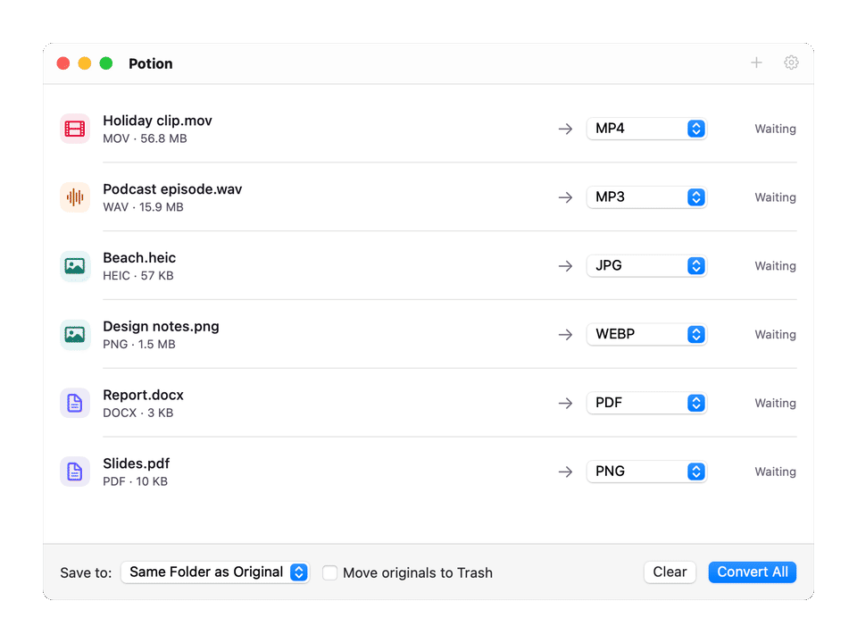
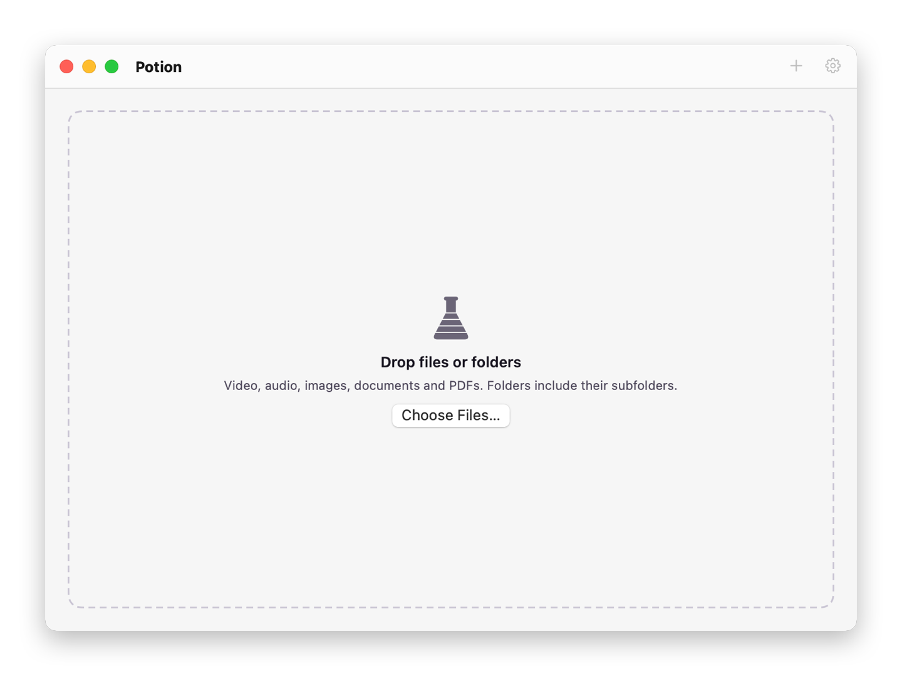
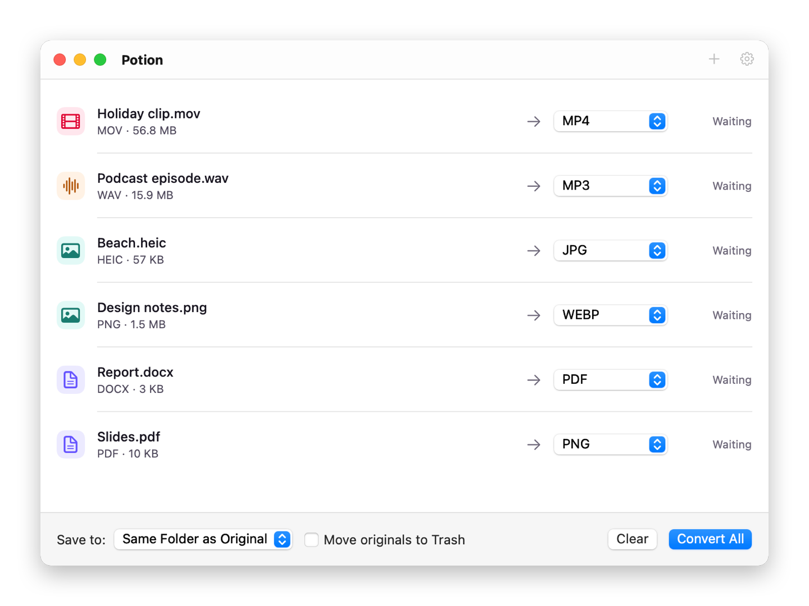
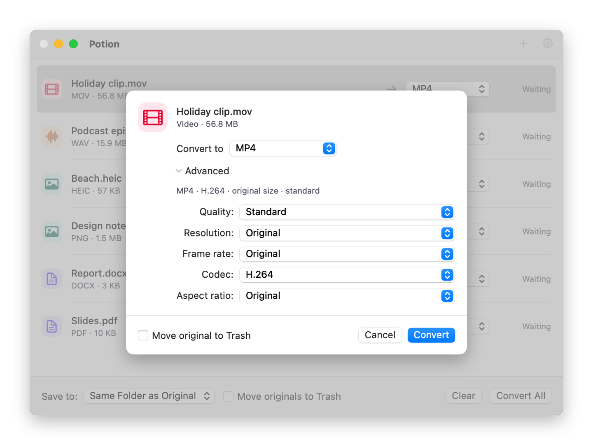
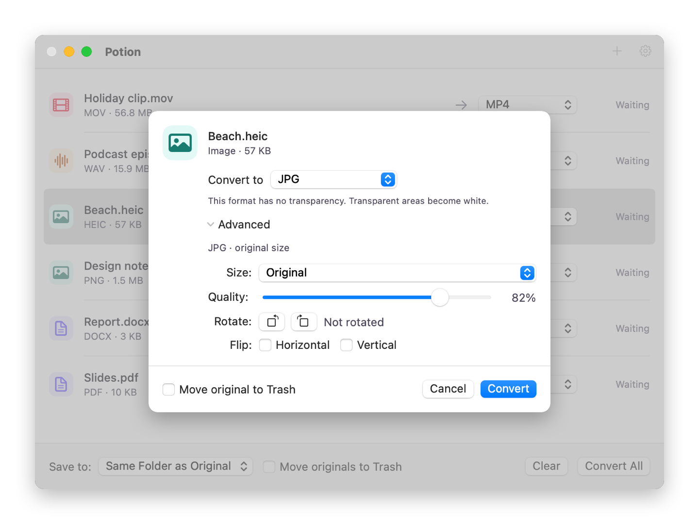
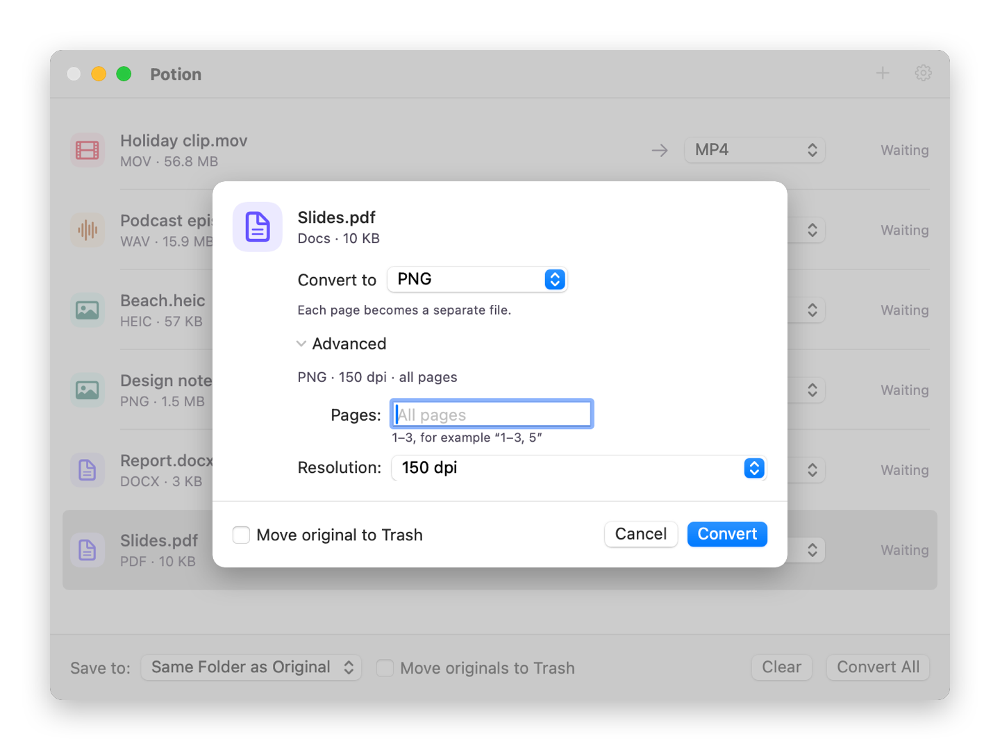
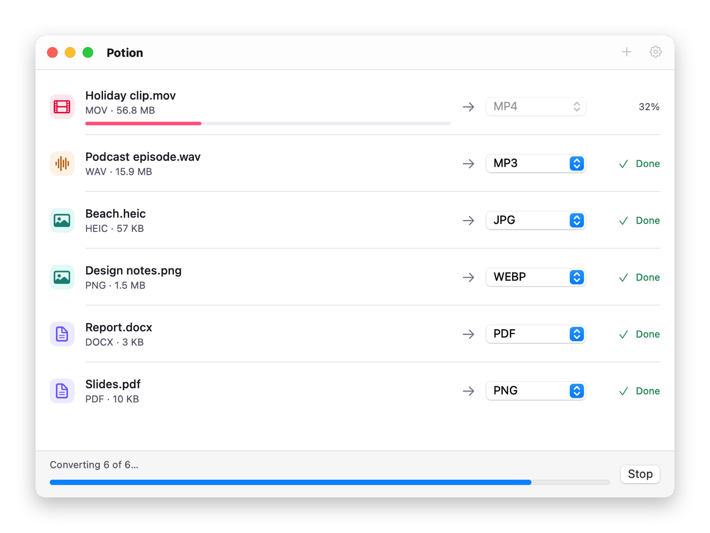
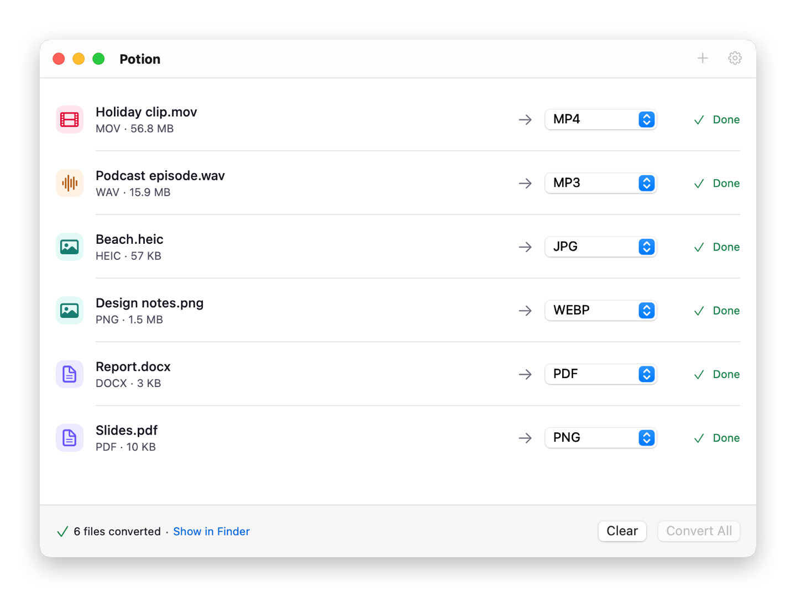
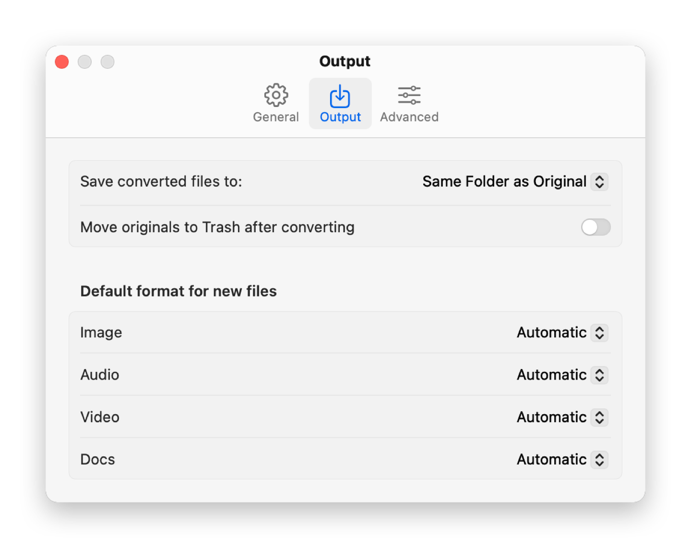

<p align="center">
  <picture>
    <source media="(prefers-color-scheme: dark)" srcset="design-system/logos/svg/potion-lockup-on-dark.svg">
    
  </picture>
</p>

<p align="center">
  <b>Any file in. The format you need out.</b><br>
  Convert video, audio, images, documents and PDFs on your own Mac. Nothing is uploaded.
</p>

<p align="center">
  <a href="https://github.com/Ny1ka/potion/releases/latest">
    <picture>
      <source media="(prefers-color-scheme: dark)" srcset="docs/images/readme/download-dark.svg">
      
    </picture>
  </a>
  <br>
  <sub>Free and open source · macOS 13 or later · Apple silicon and Intel</sub>
</p>

<p align="center">
  <picture>
    <source media="(prefers-color-scheme: dark)" srcset="docs/images/readme/demo-dark.gif">
    
  </picture>
</p>

## Why I built Potion

Whenever I'm editing videos or working on files, I keep running into the same problem: the file is never in the
format I need. An MP4 has to become an MP3 or a MOV. A DOCX has to become a PDF. A photo comes off my phone as HEIC
when the thing I'm uploading it to only takes JPG.

The usual answer is a browser converter: upload your file to someone else's server, wait, download it again, and
hope nothing was kept or added along the way. I didn't want to do that every time, so I built the converter I
wanted: one app that lives on my own computer, handles every kind of file I work with, and never uploads anything.

## Install

1. [Download the latest release](https://github.com/Ny1ka/potion/releases/latest), open `Potion-<version>.dmg` and
   drag **Potion** onto **Applications**.
2. Open Potion. This early version isn't signed by Apple yet, so the first time:
   - **macOS 15 or later:** macOS says it can't verify Potion. Click **Done**, open **System Settings › Privacy &
     Security**, scroll down and click **Open Anyway**, then confirm.
   - **macOS 13 or 14:** Control-click Potion in Applications, choose **Open**, then **Open** again.

After that it opens like any other app.

## How it works

### Drop anything

<picture>
  <source media="(prefers-color-scheme: dark)" srcset="docs/images/readme/drop-zone-dark.png">
  
</picture>

Drop files or whole folders on the window, or click **Choose Files…**. Folders bring their subfolders along. Potion
identifies each file by its contents, not just its extension, and tells you plainly about anything it can't convert.

### Convert right from Finder

Already looking at the file you need in a different format? You don't have to open Potion first:

1. In Finder, select one or more files.
2. Control-click (or right-click) them and choose **Convert with Potion**. Depending on your macOS version and how
   many services you have, it's at the bottom of the menu or under **Services** (or **Quick Actions › Services**).
3. Potion opens with just those files and their convert options, ready for you to pick a format and click
   **Convert**.

Tip: to give it a keyboard shortcut, open **System Settings › Keyboard › Keyboard Shortcuts › Services**, find
**Convert with Potion** under Files and Folders, and add one. If the item doesn't show up right after you install
Potion, open Potion once, or log out and back in, so macOS picks it up.

### Every file gets the right format

<picture>
  <source media="(prefers-color-scheme: dark)" srcset="docs/images/readme/queue-dark.png">
  
</picture>

Each file shows what it is and what it'll become. Pick a format per file, select several and change them together,
or, when every file is the same kind, set one format for all of them with **Convert all to**. Potion only offers conversions that actually work, and conversions that lose
something (like PDF to Word) say what they'll change before you start.

### Fine-tune when you want to

<table>
  <tr>
    <td width="33%">
      <picture>
        <source media="(prefers-color-scheme: dark)" srcset="docs/images/readme/options-video-dark.png">
        
      </picture>
    </td>
    <td width="33%">
      <picture>
        <source media="(prefers-color-scheme: dark)" srcset="docs/images/readme/options-image-dark.png">
        
      </picture>
    </td>
    <td width="33%">
      <picture>
        <source media="(prefers-color-scheme: dark)" srcset="docs/images/readme/options-pdf-dark.png">
        
      </picture>
    </td>
  </tr>
  <tr>
    <td><b>Video:</b> quality, resolution, frame rate, codec (H.264, HEVC and more) and aspect ratio.</td>
    <td><b>Images:</b> size, quality, rotation and flipping.</td>
    <td><b>PDF:</b> which pages and at what resolution.</td>
  </tr>
</table>

Double-click a file (or press ⌘I) for its options. The defaults are sensible, so you only open this when you need to.
Audio gets bitrate and sample rate; Potion never upscales video and keeps quality whenever it can copy streams
instead of re-encoding.

### Convert everything at once

<picture>
  <source media="(prefers-color-scheme: dark)" srcset="docs/images/readme/converting-dark.png">
  
</picture>

Click **Convert All** (⌘↩). Files convert side by side with their own progress, the Dock icon shows how many are left,
and **Stop** cancels cleanly. If you switch to another app, Potion sends a notification when the batch is done.

<picture>
  <source media="(prefers-color-scheme: dark)" srcset="docs/images/readme/done-dark.png">
  
</picture>

Converted files never replace anything. They're saved next to the originals (or in a folder you choose) under a new
name, and each one is checked before it's saved. You can move the originals to the Trash once a conversion succeeds.

### Settings

<picture>
  <source media="(prefers-color-scheme: dark)" srcset="docs/images/readme/settings-dark.png">
  
</picture>

Choose where converted files go, whether originals move to the Trash, the default format for each kind of file, how
many files convert at once, and whether you get notifications.

## What Potion converts

<table>
  <tr>
    <td width="64" align="center">
      <picture>
        <source media="(prefers-color-scheme: dark)" srcset="docs/images/readme/tile-video-dark.svg">
        
      </picture>
    </td>
    <td><b>Video</b><br>MP4, MOV, MKV, WEBM, AVI, M4V, MPEG, WMV, 3GP, TS and more. Change format, size and quality,
      extract the audio, or turn a clip into a GIF.</td>
  </tr>
  <tr>
    <td align="center">
      <picture>
        <source media="(prefers-color-scheme: dark)" srcset="docs/images/readme/tile-audio-dark.svg">
        
      </picture>
    </td>
    <td><b>Audio</b><br>MP3, WAV, M4A, ALAC, AAC, FLAC, OGG, OPUS, AIFF and more, with bitrate and sample rate
      choices. Cover art comes along where the format allows.</td>
  </tr>
  <tr>
    <td align="center">
      <picture>
        <source media="(prefers-color-scheme: dark)" srcset="docs/images/readme/tile-image-dark.svg">
        
      </picture>
    </td>
    <td><b>Images</b><br>PNG, JPG, WEBP, HEIC, TIFF, BMP, GIF, ICO and AVIF, from those and from SVG and camera RAW
      files (DNG, CR2, CR3, NEF, ARW, RAF, ORF, RW2). Resize, rotate, flip, or combine images into one PDF.</td>
  </tr>
  <tr>
    <td align="center">
      <picture>
        <source media="(prefers-color-scheme: dark)" srcset="docs/images/readme/tile-docs-dark.svg">
        
      </picture>
    </td>
    <td><b>Documents and PDF</b><br>DOCX, DOC, ODT, RTF, TXT, HTML, Markdown and EPUB, to each other and to PDF.
      PDFs become images or documents, and can be merged, split, reordered, compressed or have pages extracted.</td>
  </tr>
</table>

Copy-protected files are refused with a clear message: Potion doesn't remove copy protection.

## Private by design

- Potion makes no network connections. Your files never leave your Mac.
- No account, no analytics, no tracking, no crash reporting.
- It uses the tools built into macOS (AVFoundation, VideoToolbox, ImageIO, PDFKit) wherever it can, and runs an
  LGPL build of FFmpeg as a separate program for everything else.

Read the [Privacy Policy](legal/PRIVACY.md) and [Terms of Use](legal/TERMS.md). Both are also in Potion's About window.

## Potion Dropper

Potion Dropper is a companion app I'm still developing: it downloads a file from a link you're allowed to download
from, then converts it with the same engine as Potion. It's experimental and isn't available as a download.

## Roadmap

- **Windows:** Potion for Windows is built and will be released after testing on Windows PCs.
- **Signed releases:** future versions will be signed and notarized by Apple, so the first-launch steps go away.
- Found a problem or have an idea? Write to nyikabusiness@gmail.com.

## Building from source

You need Xcode 15 or later and [XcodeGen](https://github.com/yonaskolb/XcodeGen) (`brew install xcodegen`).

```bash
make setup                        # enables the git hooks and checks your tools
scripts/ffmpeg/build-macos.sh     # builds the LGPL FFmpeg into build/ffmpeg/macos (needs nasm and cmake)
make test                         # runs the tests for both platforms' cores
make run-potion-macos             # builds and opens Potion
```

The README screenshots come from the real app: `scripts/readme/capture.sh` runs a scripted tour in a Debug build and
`scripts/readme/assets.py` draws the graphics from the design system.

<details>
<summary>What's in this repository</summary>

| Path | Contents |
|---|---|
| `apps/` | The app projects (macOS: SwiftUI; Windows: WinUI 3) |
| `core/` | The conversion engines (Swift for macOS, C# for Windows) and the shared spec both are tested against |
| `design-system/` | Logos, colors, typography, components and generated platform assets |
| `docs/` | Architecture, progress, legal review and release notes |
| `legal/` | Terms, privacy policy, third-party notices and license texts |
| `scripts/` | FFmpeg build, release, legal and README tooling |

</details>

## License

Potion is open source under the [MIT License](LICENSE). The Potion and Potion Dropper names and logos aren't covered by
the license. Potion includes third-party software, listed with its licenses in
[THIRD_PARTY_NOTICES.md](legal/THIRD_PARTY_NOTICES.md); the FFmpeg sources used for each release are attached to it.
